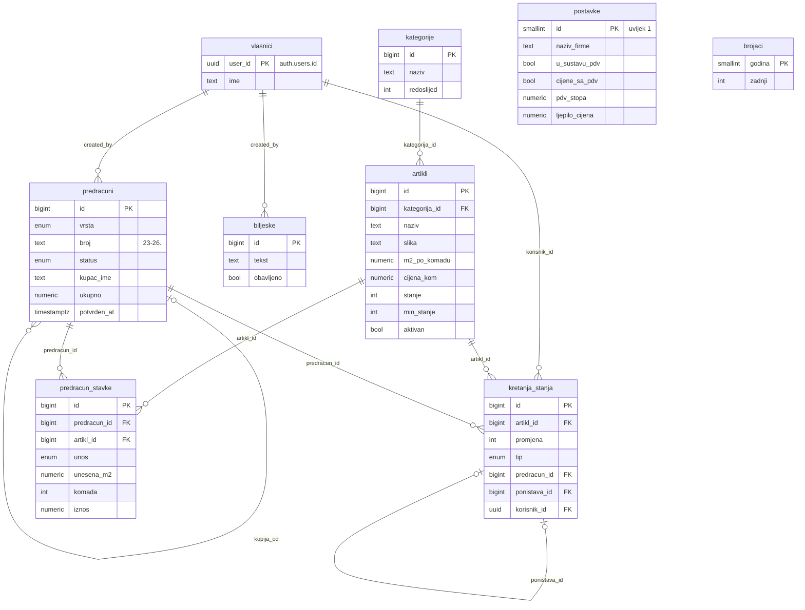

# DB – shema baze (Supabase Postgres)

> Shema za aplikaciju iz [PRD.md](PRD.md). Tehnički kontekst je u [Tech.md](Tech.md).
> Migracije se primjenjuju preko Supabase MCP-a (`apply_migration`) redom iz §9. Nakon toga pokreće se `get_advisors` i `generate_typescript_types`.
> Posljednja izmjena: 18. 11. 2026.

---

## 1. Načela

- **Primarni ključevi**: `bigint generated always as identity`. Iznimka je `vlasnici.user_id`, koji je `uuid` iz Supabase Auth.
- **Novac**: `numeric(10,2)` za cijene i `numeric(12,2)` za zbrojeve, nikad `float`.
- **Vrijeme**: uvijek `timestamptz`. Prikaz i „ovaj mjesec" računaju se u zoni `Europe/Sarajevo`.
- **Tekst**: `text`, bez `varchar(n)`.
- **Nazivi**: mala slova, `snake_case`, hrvatski bez dijakritika (`biljeske`, `kretanja_stanja`).
- **Svaki strani ključ ima indeks.**
- **RLS je uključen na svim tablicama.** Pristup imaju samo korisnici upisani u `vlasnici`, provjera ide preko `private.je_vlasnik()`.
- **Stanje se ne može razići s povijesti**:
  - `artikli.stanje` mijenja **isključivo** trigger na `kretanja_stanja`;
  - u `kretanja_stanja`, `predracuni` i `predracun_stavke` upisuju se **samo RPC funkcije** (`security definer` + provjera vlasnika). Korisnici ih mogu samo čitati.
- **Pomoćne funkcije** su u shemi `private`, koja nije izložena preko API-ja.

## 2. ER dijagram



## 3. Enumi

```sql
create type public.tip_kretanja    as enum ('ulaz', 'predracun', 'brza_prodaja', 'storno', 'ponistenje');
create type public.vrsta_prodaje   as enum ('predracun', 'brza_prodaja');
create type public.status_predracuna as enum ('otvoren', 'potvrden', 'odbijen', 'storniran');
create type public.jedinica_unosa  as enum ('m2', 'kom');
create type public.tip_popusta     as enum ('posto', 'km');
```

## 4. Tablice

### 4.1 `vlasnici` – tko smije koristiti aplikaciju

```sql
create table public.vlasnici (
  user_id    uuid primary key references auth.users (id) on delete cascade,
  ime        text not null,                      -- prikaz u povijesti („Ivan")
  created_at timestamptz not null default now()
);
```

- Red se upisuje ručno (SQL/MCP) nakon kreiranja korisnika u Auth dashboardu.
- Bez reda u ovoj tablici prijavljeni korisnik ne vidi ništa. To je zaštita ako se registracija ikad slučajno uključi.

### 4.2 `postavke` – jedan red

```sql
create table public.postavke (
  id              smallint primary key default 1 check (id = 1),
  naziv_firme     text not null,
  adresa          text,
  mjesto          text,
  telefon         text,
  email           text,
  jib             text,
  pdv_broj        text,
  u_sustavu_pdv   boolean not null default false,
  cijene_sa_pdv   boolean not null default true,     -- unesene cijene uključuju PDV
  pdv_stopa       numeric(5,2) not null default 17 check (pdv_stopa between 0 and 100),
  ljepilo_cijena  numeric(10,2) not null default 0 check (ljepilo_cijena >= 0),
  -- zaglavlje PDF predračuna (0010_predracun_excel_predlozak)
  vlasnik             text,                           -- na PDF-u „vl. <vlasnik>” uz naziv
  banka               text,
  transakcijski_racun text,
  web                 text,                           -- kontakti gore desno, svaki s ikonom
  instagram           text,
  whatsapp            text,
  viber               text,
  updated_at      timestamptz not null default now()
);
```

### 4.3 `kategorije`

```sql
create table public.kategorije (
  id         bigint generated always as identity primary key,
  naziv      text not null unique check (length(trim(naziv)) > 0),
  redoslijed integer not null default 0,
  created_at timestamptz not null default now()
);
```

- Brisanje kategorije u kojoj ima obloga blokira `on delete restrict` na `artikli`. UI prikaže poruku „Kategorija nije prazna".

### 4.4 `artikli` – obloge

```sql
create table public.artikli (
  id            bigint generated always as identity primary key,
  kategorija_id bigint not null references public.kategorije (id) on delete restrict,
  naziv         text not null check (length(trim(naziv)) > 0),
  slika         text,                                   -- '/slike/obloge/x.jpg' ili putanja u Storageu
  sirina_cm     numeric(8,2) check (sirina_cm > 0),
  duzina_cm     numeric(8,2) check (duzina_cm > 0),
  m2_po_komadu  numeric(10,4) check (m2_po_komadu > 0), -- null = unos samo u komadima
  cijena_kom    numeric(10,2) not null check (cijena_kom >= 0),
  stanje        integer not null default 0,             -- mijenja SAMO trigger; smije < 0
  min_stanje    integer not null default 0 check (min_stanje >= 0),
  aktivan       boolean not null default true,          -- false = arhivirano
  created_at    timestamptz not null default now(),
  updated_at    timestamptz not null default now()
);

create index artikli_kategorija_id_idx on public.artikli (kategorija_id);
create unique index artikli_naziv_aktivan_uk on public.artikli (lower(naziv)) where aktivan;
```

- `m2_po_komadu` u UI-u se predlaže kao `sirina_cm × duzina_cm / 10000` i može se izmijeniti.
- **Nisko stanje**: `stanje <= min_stanje`. **Minus**: `stanje < 0`.

### 4.5 `kretanja_stanja` – povijest (samo dodavanje)

```sql
create table public.kretanja_stanja (
  id           bigint generated always as identity primary key,
  artikl_id    bigint not null references public.artikli (id) on delete restrict,
  promjena     integer not null check (promjena <> 0),   -- + ulaz, − izlaz
  tip          public.tip_kretanja not null,
  predracun_id bigint references public.predracuni (id) on delete restrict,
  ponistava_id bigint unique references public.kretanja_stanja (id) on delete restrict,
  napomena     text,
  korisnik_id  uuid default auth.uid() references public.vlasnici (user_id) on delete set null,
  created_at   timestamptz not null default now(),

  constraint kretanje_ulaz_ck        check (tip <> 'ulaz'       or (promjena > 0 and predracun_id is null and ponistava_id is null)),
  constraint kretanje_izlaz_ck       check (tip not in ('predracun','brza_prodaja') or (promjena < 0 and predracun_id is not null)),
  constraint kretanje_storno_ck      check (tip <> 'storno'     or (promjena > 0 and predracun_id is not null)),
  constraint kretanje_ponistenje_ck  check (tip <> 'ponistenje' or (promjena < 0 and ponistava_id is not null))
);

create index kretanja_artikl_vrijeme_idx on public.kretanja_stanja (artikl_id, created_at desc);
create index kretanja_predracun_id_idx  on public.kretanja_stanja (predracun_id);
create index kretanja_korisnik_id_idx   on public.kretanja_stanja (korisnik_id);
-- ponistava_id ima indeks preko UNIQUE
```

- **Poništen ulaz** = postoji kretanje s `ponistava_id = id tog ulaza`. `UNIQUE` jamči da se ulaz može poništiti samo jednom.
- Tablica se kreira **nakon** `predracuni` (zbog FK-a). Redoslijed je u §9.

### 4.6 `brojaci` – brojač predračuna po godini

```sql
create table public.brojaci (
  godina smallint primary key,
  zadnji integer not null default 0
);
```

### 4.7 `predracuni` – predračuni i brze prodaje

```sql
create table public.predracuni (
  id                 bigint generated always as identity primary key,
  vrsta              public.vrsta_prodaje not null default 'predracun',
  godina             smallint,
  redni_broj         integer,
  broj               text generated always as (
                       case when redni_broj is null then null
                            else redni_broj::text || '-' || lpad((godina % 100)::text, 2, '0') || '.'
                       end) stored,                     -- "23-26." (Excel predložak, od 0010)
  status             public.status_predracuna not null default 'otvoren',

  -- kupac (bez baze kupaca)
  kupac_ime          text,
  kupac_telefon      text,
  kupac_mjesto       text,
  kupac_adresa       text,                                -- od 0010
  kupac_jib          text,
  napomena           text,                                -- interna, ne ide na PDF

  -- uvjeti na PDF-u (od 0010; null = prazno na PDF-u)
  svrha              text,
  nacin_placanja     text,                                -- uređivač predlaže „gotovinsko”
  datum_isporuke     date,
  vrijedi_dana       smallint check (vrijedi_dana between 1 and 365),  -- uređivač predlaže 15

  -- dodaci (null = isključeno)
  ugradnja_m2        numeric(10,2) check (ugradnja_m2 > 0),
  ugradnja_cijena_m2 numeric(10,2) check (ugradnja_cijena_m2 >= 0),
  ljepilo_kom        integer       check (ljepilo_kom > 0),
  ljepilo_cijena     numeric(10,2) check (ljepilo_cijena >= 0),
  prijevoz           numeric(10,2) check (prijevoz >= 0),

  -- popust (null = bez popusta)
  popust_tip         public.tip_popusta,
  popust_vrijednost  numeric(10,2) check (popust_vrijednost >= 0),

  -- snimak PDV postavki u trenutku kreiranja
  pdv_u_sustavu      boolean not null,
  pdv_cijene_sa_pdv  boolean not null,
  pdv_stopa          numeric(5,2) not null,

  -- izračunati iznosi (računa lib/kalkulacija.ts na serveru)
  medjuzbroj         numeric(12,2) not null,
  popust_iznos       numeric(12,2) not null default 0,
  osnovica           numeric(12,2) not null,
  pdv_iznos          numeric(12,2) not null default 0,
  ukupno             numeric(12,2) not null,

  kopija_od          bigint references public.predracuni (id) on delete set null,
  created_by         uuid default auth.uid() references public.vlasnici (user_id) on delete set null,
  created_at         timestamptz not null default now(),
  updated_at         timestamptz not null default now(),
  potvrden_at        timestamptz,
  storniran_at       timestamptz,

  constraint predracun_broj_uk        unique (godina, redni_broj),
  constraint predracun_broj_ck        check ((vrsta = 'predracun') = (godina is not null and redni_broj is not null)),
  constraint predracun_ugradnja_ck    check ((ugradnja_m2 is null) = (ugradnja_cijena_m2 is null)),
  constraint predracun_ljepilo_ck     check ((ljepilo_kom is null) = (ljepilo_cijena is null)),
  constraint predracun_popust_ck      check ((popust_tip is null) = (popust_vrijednost is null)),
  constraint predracun_popust_posto_ck check (popust_tip is distinct from 'posto' or popust_vrijednost <= 100),
  constraint predracun_potvrden_ck    check (status not in ('potvrden','storniran') or potvrden_at is not null),
  constraint brza_prodaja_ck          check (vrsta = 'predracun' or (
                                         status in ('potvrden','storniran')
                                         and ugradnja_m2 is null and ljepilo_kom is null and prijevoz is null))
);

create index predracuni_status_created_idx on public.predracuni (status, created_at desc);
create index predracuni_potvrden_at_idx    on public.predracuni (potvrden_at) where status in ('potvrden','storniran');
create index predracuni_kopija_od_idx      on public.predracuni (kopija_od);
create index predracuni_created_by_idx     on public.predracuni (created_by);
```

**Prijelazi statusa** (provode ih samo RPC funkcije):

```
otvoren ──potvrdi──▶ potvrden ──storniraj──▶ storniran
   └─────odbij─────▶ odbijen
brza_prodaja: nastaje kao potvrden ──storniraj──▶ storniran
```

### 4.8 `predracun_stavke`

```sql
create table public.predracun_stavke (
  id            bigint generated always as identity primary key,
  predracun_id  bigint not null references public.predracuni (id) on delete cascade,
  redoslijed    smallint not null,
  artikl_id     bigint not null references public.artikli (id) on delete restrict,
  naziv         text not null,                 -- snimak naziva
  cijena_kom    numeric(10,2) not null,        -- snimak cijene
  m2_po_komadu  numeric(10,4),                 -- snimak
  unos          public.jedinica_unosa not null,
  unesena_m2    numeric(10,2) check (unesena_m2 > 0),
  komada        integer not null check (komada > 0),
  iznos         numeric(12,2) not null,

  constraint stavka_unos_ck check ((unos = 'm2') = (unesena_m2 is not null)),
  constraint stavka_m2_ck   check (unos = 'kom' or m2_po_komadu is not null)
);

create index predracun_stavke_predracun_id_idx on public.predracun_stavke (predracun_id);
create index predracun_stavke_artikl_id_idx    on public.predracun_stavke (artikl_id);
```

### 4.9 `biljeske`

```sql
create table public.biljeske (
  id           bigint generated always as identity primary key,
  tekst        text not null check (length(trim(tekst)) > 0),
  obavljeno    boolean not null default false,
  obavljeno_at timestamptz,
  created_by   uuid default auth.uid() references public.vlasnici (user_id) on delete set null,
  created_at   timestamptz not null default now(),
  updated_at   timestamptz not null default now()
);

create index biljeske_obavljeno_created_idx on public.biljeske (obavljeno, created_at desc);
create index biljeske_created_by_idx        on public.biljeske (created_by);
```

## 5. Funkcije i triggeri

### 5.1 Pomoćne (shema `private`, nije izložena API-ju)

```sql
create schema if not exists private;

-- Je li trenutni korisnik vlasnik?
create function private.je_vlasnik() returns boolean
language sql stable security definer set search_path = ''
as $$
  select exists (select 1 from public.vlasnici where user_id = (select auth.uid()));
$$;

-- Sljedeći redni broj predračuna za godinu (atomski)
create function private.sljedeci_redni_broj(p_godina smallint) returns integer
language sql set search_path = ''
as $$
  insert into public.brojaci (godina, zadnji) values (p_godina, 1)
  on conflict (godina) do update set zadnji = public.brojaci.zadnji + 1
  returning zadnji;
$$;

-- updated_at
create function private.postavi_updated_at() returns trigger
language plpgsql set search_path = ''
as $$ begin new.updated_at := now(); return new; end $$;

-- Stanje = stanje + promjena (jedino mjesto gdje se mijenja artikli.stanje)
create function private.azuriraj_stanje() returns trigger
language plpgsql security definer set search_path = ''
as $$
begin
  update public.artikli set stanje = stanje + new.promjena where id = new.artikl_id;
  return new;
end $$;
```

### 5.2 Triggeri

```sql
create trigger kretanja_azuriraj_stanje after insert on public.kretanja_stanja
  for each row execute function private.azuriraj_stanje();

create trigger artikli_updated_at    before update on public.artikli    for each row execute function private.postavi_updated_at();
create trigger predracuni_updated_at before update on public.predracuni for each row execute function private.postavi_updated_at();
create trigger biljeske_updated_at   before update on public.biljeske   for each row execute function private.postavi_updated_at();
create trigger postavke_updated_at   before update on public.postavke   for each row execute function private.postavi_updated_at();
```

### 5.3 RPC funkcije (`public`, poziva ih aplikacija)

Zajedničko svim RPC funkcijama koje pišu:
- `language plpgsql security definer set search_path = ''`;
- prva linija: `if not private.je_vlasnik() then raise exception 'Nemate pristup.' using errcode = '42501'; end if;`;
- greške imaju poruke na hrvatskom (`errcode = 'P0001'`), a UI ih prikazuje izravno;
- `revoke execute … from public, anon; grant execute … to authenticated;`.

| Funkcija | Vraća | Što radi |
|---|---|---|
| `ulaz_robe(p_stavke jsonb, p_napomena text default null)` | `integer` (broj upisanih) | Skupni ulaz. `p_stavke = [{"artikl_id":1,"kolicina":50}, …]`. Preskače količine 0, a negativne odbija (check). Za svaku stavku jedno kretanje `tip='ulaz'` s istom napomenom. |
| `ponisti_ulaz(p_kretanje_id bigint)` | `void` | Kretanje mora biti `tip='ulaz'`. Upisuje `tip='ponistenje'`, `promjena = −original`, `ponistava_id = original.id`, napomena „Poništen ulaz od DD.MM.GGGG.". Drugi pokušaj blokira `UNIQUE(ponistava_id)`, a greška se prevodi u „Ovaj ulaz je već poništen.". |
| `spremi_predracun(p_id bigint, p_podaci jsonb)` | `bigint` (id) | `p_id is null` → **novi**: godina u `Europe/Sarajevo`, `redni_broj = private.sljedeci_redni_broj(godina)`, status `otvoren`, PDV snimak iz `p_podaci`. `p_id` zadan → **izmjena**: `update … where id = p_id and vrsta='predracun' and status='otvoren'` (inače greška „Predračun se može urediti samo dok je otvoren."), PDV snimak se ne mijenja, stavke se brišu i upisuju ponovno. Stavke se čitaju iz `p_podaci->'stavke'` preko `jsonb_to_recordset … with ordinality` (redoslijed). |
| `potvrdi_predracun(p_id bigint)` | `void` | `select … for update`. Mora biti `vrsta='predracun'` i `status='otvoren'`. Postavlja `status='potvrden'`, `potvrden_at=now()` i upisuje `kretanja (artikl_id, −komada, 'predracun', p_id)` za svaku stavku. Manjak se **ne** blokira (stanje smije u minus). UI upozorenje se računa prije poziva. |
| `odbij_predracun(p_id bigint)` | `void` | `otvoren` → `odbijen`. |
| `storniraj_predracun(p_id bigint)` | `void` | Mora biti `status='potvrden'` (oba tipa: predračun i brza prodaja). Postavlja `status='storniran'`, `storniran_at=now()` i upisuje `kretanja (artikl_id, +komada, 'storno', p_id)` po stavci. |
| `brza_prodaja(p_podaci jsonb)` | `bigint` (id) | Kreira `vrsta='brza_prodaja'`, `status='potvrden'`, `potvrden_at=now()`, bez broja i dodataka, s popustom i PDV snimkom. Upisuje stavke i kretanja `tip='brza_prodaja'`. Sve u jednoj transakciji. |
| `obrisi_oblogu(p_id bigint)` | `text` (stara `slika`) | Trajno briše oblogu koja **nikad nije prodana**: nema je ni u jednom `predracun_stavke` i nema kretanja osim `ulaz`/`ponistenje` (inače greška „… ne može se obrisati. Možete je arhivirati."). Briše poništenja, pa ulaze (FK `ponistava_id`), pa artikl. Datoteke u Storageu (`artikli/{id}/`) briše Server Action. |
| `ping()` | `timestamptz` | `select now()`, `stable`, `security invoker`. **Jedina** funkcija dostupna `anon` ulozi. Služi za keepalive (Vercel Cron). |

**Oblik `p_podaci`** (`spremi_predracun`, `brza_prodaja`):

```json
{
  "kupac_ime": "Amir H.", "kupac_telefon": "061 123 456", "kupac_mjesto": "Sarajevo",
  "kupac_adresa": "Glavna 12", "kupac_jib": "", "svrha": "", "nacin_placanja": "gotovinsko",
  "datum_isporuke": null, "vrijedi_dana": 15,
  "napomena": "Zove poslije 16h",
  "ugradnja_m2": 12.5, "ugradnja_cijena_m2": 15.00,
  "ljepilo_kom": 4, "ljepilo_cijena": 12.00,
  "prijevoz": 25.00,
  "popust_tip": "posto", "popust_vrijednost": 5,
  "pdv_u_sustavu": false, "pdv_cijene_sa_pdv": true, "pdv_stopa": 17,
  "medjuzbroj": 876.50, "popust_iznos": 43.83, "osnovica": 832.67, "pdv_iznos": 0, "ukupno": 832.67,
  "kopija_od": null,
  "stavke": [
    { "artikl_id": 1, "naziv": "WPC panel 16×280 – Svijetli hrast", "cijena_kom": 22.00,
      "m2_po_komadu": 0.448, "unos": "m2", "unesena_m2": 12.5, "komada": 28, "iznos": 616.00 }
  ]
}
```

- Iznose računa **Server Action** funkcijom `lib/kalkulacija.ts`. RPC ih sprema, a ne računa.
- **Kopiraj** nema svoju RPC funkciju. Server Action pročita original, uzme trenutne cijene artikala, ponovno izračuna i pozove `spremi_predracun(null, … "kopija_od": id)`.

**Primjer implementacije** (`potvrdi_predracun`):

```sql
create function public.potvrdi_predracun(p_id bigint) returns void
language plpgsql security definer set search_path = ''
as $$
declare
  v_status public.status_predracuna;
begin
  if not private.je_vlasnik() then
    raise exception 'Nemate pristup.' using errcode = '42501';
  end if;

  select status into v_status
  from public.predracuni
  where id = p_id and vrsta = 'predracun'
  for update;

  if not found then
    raise exception 'Predračun ne postoji.' using errcode = 'P0001';
  end if;
  if v_status <> 'otvoren' then
    raise exception 'Samo otvoren predračun se može potvrditi.' using errcode = 'P0001';
  end if;

  update public.predracuni
     set status = 'potvrden', potvrden_at = now()
   where id = p_id;

  insert into public.kretanja_stanja (artikl_id, promjena, tip, predracun_id)
  select artikl_id, -komada, 'predracun', p_id
  from public.predracun_stavke
  where predracun_id = p_id;
end $$;

revoke execute on function public.potvrdi_predracun(bigint) from public, anon;
grant  execute on function public.potvrdi_predracun(bigint) to authenticated;
```

## 6. Prava i RLS

### 6.1 Prava na tablice (GRANT)

Na ovom projektu nove tablice **ne** dobivaju automatski `select/insert/update/delete` za `anon` i `authenticated` (samo `truncate/references/trigger/maintain`), a nove funkcije ne dobivaju `execute`. Zato se prvo sve oduzme, a onda se izričito dodijeli samo ono što treba. Puni SQL je u `supabase/migrations/0006_prava_rls.sql`.

```sql
-- polazište: nitko ništa (uklanja i TRUNCATE, koji RLS ne blokira)
revoke all on all tables in schema public from anon, authenticated;

-- čitanje: sve tablice osim brojaci
grant select on public.vlasnici, public.postavke, public.kategorije, public.artikli,
  public.kretanja_stanja, public.predracuni, public.predracun_stavke, public.biljeske
  to authenticated;

grant update on public.postavke to authenticated;                                     -- bez insert/delete
grant insert, update, delete on public.kategorije, public.biljeske to authenticated;  -- puni CRUD

-- artikli: sve osim stupca stanje
grant insert (kategorija_id, naziv, slika, sirina_cm, duzina_cm, m2_po_komadu, cijena_kom, min_stanje, aktivan)
  on public.artikli to authenticated;
grant update (kategorija_id, naziv, slika, sirina_cm, duzina_cm, m2_po_komadu, cijena_kom, min_stanje, aktivan)
  on public.artikli to authenticated;

-- private shema: samo izvršavanje provjere vlasnika (koriste je politike)
grant usage on schema private to authenticated;
revoke execute on all functions in schema private from public, anon, authenticated;
grant execute on function private.je_vlasnik() to authenticated;
```

### 6.2 RLS politike

`alter table … enable row level security;` na **svim** tablicama. Svaka politika koristi isti uvjet:

```sql
-- obrazac
create policy "vlasnici_select" on public.<tablica>
  for select to authenticated
  using ((select private.je_vlasnik()));
```

| Tablica | select | insert | update | delete |
|---|---|---|---|---|
| `vlasnici` | ✔ | – | – | – |
| `postavke` | ✔ | – | ✔ | – |
| `kategorije` | ✔ | ✔ | ✔ | ✔ (FK blokira ako nije prazna) |
| `artikli` | ✔ | ✔ (bez `stanje`) | ✔ (bez `stanje`) | RPC `obrisi_oblogu` (samo nikad prodane; inače arhiviranje) |
| `kretanja_stanja` | ✔ | RPC | – | – |
| `brojaci` | – | RPC | RPC | – |
| `predracuni` | ✔ | RPC | RPC | – |
| `predracun_stavke` | ✔ | RPC | RPC | RPC |
| `biljeske` | ✔ | ✔ | ✔ | ✔ |

✔ = politika `to authenticated` s `(select private.je_vlasnik())` u `using` / `with check`.
„RPC" = nema politike ni prava. Piše samo `security definer` funkcija iz §5.3, koja sama provjerava vlasnika.

## 7. Storage

```sql
insert into storage.buckets (id, name, public, file_size_limit, allowed_mime_types)
values ('slike-obloga', 'slike-obloga', true, 2097152,             -- 2 MB
        array['image/webp', 'image/jpeg', 'image/png']);

create policy "slike_select" on storage.objects for select to authenticated
  using (bucket_id = 'slike-obloga' and (select private.je_vlasnik()));
create policy "slike_insert" on storage.objects for insert to authenticated
  with check (bucket_id = 'slike-obloga' and (select private.je_vlasnik()));
create policy "slike_update" on storage.objects for update to authenticated
  using (bucket_id = 'slike-obloga' and (select private.je_vlasnik()))
  with check (bucket_id = 'slike-obloga' and (select private.je_vlasnik()));
create policy "slike_delete" on storage.objects for delete to authenticated
  using (bucket_id = 'slike-obloga' and (select private.je_vlasnik()));
```

- Bucket je **javan za čitanje preko URL-a** (slike obloga nisu povjerljive). Listanje, upload, izmjena i brisanje dopušteni su samo vlasnicima.
- Putanja: `artikli/{artikl_id}/{timestamp}.webp`.

## 8. Početni podaci

```sql
insert into public.kategorije (naziv, redoslijed) values
  ('PVC/SPC zidne obloge', 1),
  ('Akustični paneli',     2),
  ('CarbonWood paneli',    3),
  ('Fasadni WPC paneli',   4),
  ('Metalni paneli',       5),
  ('Zeleni zid',           6);

insert into public.postavke (id, naziv_firme, adresa, mjesto, telefon, email)
values (1, 'Obloga.ba', 'Sarajevska b.b.', '72230 Žepče', '+387 63 766 063', 'info@obloga.ba');
-- JIB, PDV broj, PDV status i cijenu ljepila vlasnik dopunjava u Postavkama
```

**Vlasnici**, nakon kreiranja korisnika u Auth dashboardu:

```sql
insert into public.vlasnici (user_id, ime)
select id, 'Ime vlasnika' from auth.users where email = '<email vlasnika>';
```

**Obloge** (kad vlasnik dostavi listu). Početno stanje se upisuje kao **ulaz**, da povijest bude potpuna:

```sql
with a as (
  insert into public.artikli (kategorija_id, naziv, slika, sirina_cm, duzina_cm, m2_po_komadu, cijena_kom, min_stanje)
  select k.id, 'WPC panel 16×280 – Svijetli hrast', '/slike/obloge/wpc-svijetli-hrast.jpg', 16, 280, 0.448, 22.00, 10
  from public.kategorije k where k.naziv = 'Fasadni WPC paneli'
  returning id
)
insert into public.kretanja_stanja (artikl_id, promjena, tip, napomena, korisnik_id)
select id, 48, 'ulaz', 'Početno stanje', null from a;
```

## 9. Redoslijed migracija

| # | Naziv | Sadržaj |
|---|---|---|
| 1 | `0001_enumi_vlasnici_postavke_kategorije` | enumi, `private` shema, `vlasnici`, `postavke`, `kategorije` |
| 2 | `0002_artikli_predracuni` | `artikli`, `brojaci`, `predracuni`, `predracun_stavke`, `kretanja_stanja` (tim redom zbog FK) + indeksi |
| 3 | `0003_biljeske` | `biljeske` + indeksi |
| 4 | `0004_funkcije_triggeri` | `private.*` funkcije, triggeri `updated_at` i stanja |
| 5 | `0005_rpc` | `ulaz_robe`, `ponisti_ulaz`, `spremi_predracun`, `potvrdi_predracun`, `odbij_predracun`, `storniraj_predracun`, `brza_prodaja`, `ping` + `grant`/`revoke` |
| 6 | `0006_prava_rls` | GRANT/REVOKE iz §6.1, `enable row level security`, politike iz §6.2 |
| 7 | `0007_storage` | bucket i politike iz §7 |
| 8 | `0008_pocetni_podaci` | kategorije, postavke |
| 9 | `0009_obrisi_oblogu` | RPC `obrisi_oblogu` + `grant`/`revoke` |
| 10 | `0010_obloge` (kasnije) | artikli + početno stanje iz liste vlasnika |

Nakon svake: `get_advisors` (security, performance). Na kraju: `generate_typescript_types` → `utils/supabase/types.ts`.

## 10. Primjeri upita

**Prodaja ovaj mjesec** (Početna):

```sql
select coalesce(sum(ukupno), 0) as prodaja_mjesec
from public.predracuni
where status = 'potvrden'
  and potvrden_at >= (date_trunc('month', now() at time zone 'Europe/Sarajevo') at time zone 'Europe/Sarajevo')
  and potvrden_at <  ((date_trunc('month', now() at time zone 'Europe/Sarajevo') + interval '1 month') at time zone 'Europe/Sarajevo');
```

U aplikaciji se granice razdoblja računaju u TS-u (`Europe/Sarajevo`), a upit ide preko supabase-js: `.in('status', ['potvrden','storniran']).gte('potvrden_at', od).lt('potvrden_at', do)`. Zbroj se računa samo za `potvrden`.

**Nisko stanje / minus:**

```sql
select id, naziv, slika, stanje, min_stanje
from public.artikli
where aktivan and stanje <= min_stanje
order by stanje asc, naziv;
```

**Povijest kretanja obloge** (s imenom vlasnika i oznakom poništenja):

```sql
select k.id, k.created_at, k.tip, k.promjena, k.napomena,
       p.broj as predracun_broj, v.ime as vlasnik,
       exists (select 1 from public.kretanja_stanja x where x.ponistava_id = k.id) as ponisten
from public.kretanja_stanja k
left join public.predracuni p on p.id = k.predracun_id
left join public.vlasnici   v on v.user_id = k.korisnik_id
where k.artikl_id = $1
order by k.created_at desc
limit 50;
```

supabase-js:

```ts
.from('kretanja_stanja')
.select('*, predracuni(broj), vlasnici(ime), ponistenja:kretanja_stanja!ponistava_id(id)')
```

**Manjak prije potvrde** (za upozorenje u UI-u):

```sql
select s.naziv, sum(s.komada) as treba, a.stanje, sum(s.komada) - a.stanje as nedostaje
from public.predracun_stavke s
join public.artikli a on a.id = s.artikl_id
where s.predracun_id = $1
group by s.artikl_id, s.naziv, a.stanje
having sum(s.komada) > a.stanje;
```

**Broj otvorenih predračuna:**

```sql
select count(*) from public.predracuni where vrsta = 'predracun' and status = 'otvoren';
```
