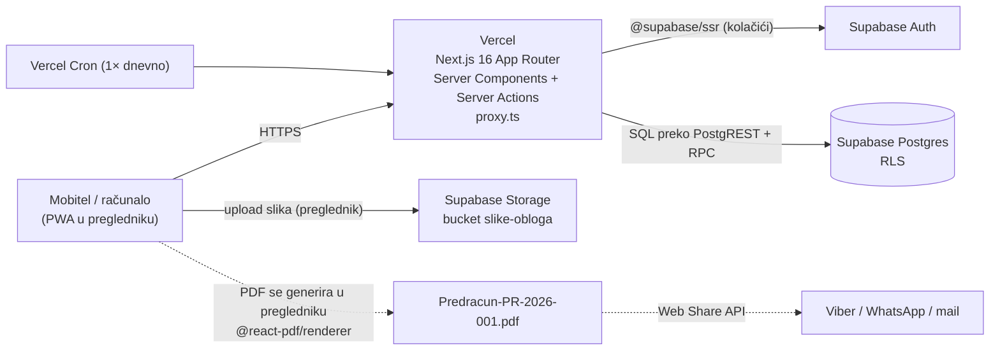

# Tech – arhitektura i tehnička implementacija

> Kako se aplikacija iz [PRD.md](PRD.md) gradi: stack, servisi, struktura i ključni tokovi. Shema baze je u [DB.md](DB.md).
> Posljednja izmjena: 20. 11. 2026.

---

## 1. Pregled arhitekture



- **Čitanje podataka**: Server Components na serveru (Vercel) preko Supabase klijenta s korisnikovom sesijom iz kolačića.
- **Izmjene**: Server Actions. Sve što mijenja stanje robe ide kroz **Postgres funkcije (RPC)** u jednoj transakciji.
- **PDF**: generira se **u pregledniku**, pa nema troška servera i brzo je.
- **Slike**: upload ide direktno iz preglednika u Supabase Storage, uz prethodno smanjivanje slike.

## 2. Što je već instalirano i postavljeno

| Stavka | Stanje |
|---|---|
| `next` | **16.4.6** (App Router; `middleware` se sada zove **`proxy.ts`**) |
| `react`, `react-dom` | **19.3.0** |
| `typescript` | ^5, alias `@/*` → korijen projekta (`tsconfig.json`) |
| `tailwindcss` | **4.3.3** preko `@tailwindcss/turbopack` (loader za `*.css` u `next.config.ts`) |
| `@supabase/ssr` | **^0.12.7** |
| `@supabase/supabase-js` | **^2.119.1** |
| `eslint` + `eslint-config-next` | ^9 / 16.4.6 |
| `next.config.ts` | `cacheComponents: true`, `partialPrefetching: true`, `experimental.agentFeedback: true` |
| `proxy.ts` | Poziva `updateSession()` na svim rutama osim statike i slika |
| `utils/supabase/server.ts` | `createClient(cookieStore)`: serverski klijent (Server Components / Actions) |
| `utils/supabase/client.ts` | `createClient()`: klijent za preglednik |
| `utils/supabase/middleware.ts` | `updateSession(request)`: osvježava sesiju preko `getClaims()` |
| `.env.local` | `NEXT_PUBLIC_SUPABASE_URL`, `NEXT_PUBLIC_SUPABASE_PUBLISHABLE_KEY` |
| `.mcp.json` | Supabase MCP server povezan s projektom (migracije, SQL, advisori, tipovi) |
| Agent skills | `supabase`, `supabase-postgres-best-practices` (`.agents/skills/`) |
| `AGENTS.md` | Prije pisanja koda pročitati vodiče u `node_modules/next/dist/docs/` |
| Supabase baza | Migracije 0001–0008 primijenjene (18. 11. 2026.), SQL u `supabase/migrations/` |
| `app/todos/page.tsx` | Primjer iz Supabase vodiča. **Briše se** |
| `app/layout.tsx`, `globals.css` | Zadani Create Next App (Geist font, `lang="en"`). **Zamjenjuje se** |

## 3. Paketi koje treba dodati

```bash
npm i @react-pdf/renderer lucide-react zod
npm i -D vitest   # uz @types/node ^24 (peer zahtjev vitesta 5)
```

| Paket | Namjena |
|---|---|
| `@react-pdf/renderer` | PDF predračuna u pregledniku. Učitava se dinamički (`import()`) tek na klik, da ne usporava aplikaciju |
| `lucide-react` | Ikone (navigacija, gumbi) |
| `zod` | Validacija ulaza u Server Actions |
| `vitest` | Unit testovi kalkulacije i formatiranja |

Namjerno **bez** UI biblioteka (shadcn, MUI…). Komponente su male i ručno pisane uz Tailwind, pa je aplikacija lagana i jednostavna za održavanje.

## 4. Struktura projekta

```
app/
  layout.tsx                 # html lang="hr", fontovi, viewport/themeColor
  manifest.ts                # PWA manifest
  globals.css                # Tailwind v4 + @theme tokeni brenda
  prijava/
    page.tsx                 # forma za prijavu
    actions.ts               # prijava (signInWithPassword), odjava
  (app)/                     # zaštićeni dio, zajednički layout
    layout.tsx               # zaglavlje s logom + donja navigacija
    page.tsx                 # Početna
    obloge/
      page.tsx               # kartice 2 u redu
      nova/page.tsx
      ulaz/page.tsx          # skupni ulaz
      [id]/page.tsx          # detalji + povijest + Poništi
      [id]/uredi/page.tsx
      actions.ts
    predracuni/
      page.tsx
      novi/page.tsx
      [id]/page.tsx          # pregled + PDF / Pošalji / Potvrdi / …
      [id]/uredi/page.tsx
      actions.ts
    prodaja/
      page.tsx               # pregled prodaje
      nova/page.tsx          # brza prodaja
      actions.ts
    biljeske/
      page.tsx
      actions.ts
    postavke/
      page.tsx
      actions.ts
  api/odrzavanje/route.ts    # keepalive za Supabase (Vercel Cron)
components/
  ui/                        # Gumb, Polje, Poruka, BrojPolje, Kartica, Cip, OznakaStatusa, Prekidac,
                             # DonjiList, PraznoStanje, Obavijest, Skeleton (nazivi hrvatski, bez dijakritika)
  biljeske/                  # NovaBiljeska, ListaBiljeski, PretragaBiljeski, PoljeTeksta
  obloge/                    # OblogaKartica, OdabirObloge (mreža sa slikama), UploadSlike
  predracun/                 # UredivacStavki, Dodaci, Popust, Zbroj (sticky), StatusBadge
  pdf/PredracunPdf.tsx       # @react-pdf dokument
  pdf/PdfGumbi.tsx           # Preuzmi / Pošalji (client)
  pwa/RegistracijaSW.tsx     # registracija service workera
  pwa/IosUputa.tsx           # traka „Dodaj na početni zaslon"
lib/
  kalkulacija.ts             # čista funkcija izračuna (dijele je UI, server i PDF)
  kalkulacija.test.ts
  format.ts                  # formatKM, formatM2, parseBroj, formatDatum(Kratko) (Europe/Sarajevo)
  format.test.ts
  akcije.ts                  # StanjeForme, greskeIzZoda, zBroj, postaviObavijest (za Server Actions)
  slike.ts                   # smanjivanje slike (canvas → WebP) + URL helper
  data/                      # 'server-only' funkcije za čitanje (DAL)
    obloge.ts, predracuni.ts, prodaja.ts, biljeske.ts, postavke.ts
utils/supabase/
  server.ts, client.ts, middleware.ts   # postojeće
  types.ts                   # generirani tipovi baze (Supabase MCP)
public/
  slike/logo/                # logo.png (dostavlja vlasnik)
  slike/obloge/              # početne slike obloga (dostavlja vlasnik)
  ikone/                     # PWA ikone 192/512/maskable, apple-touch-icon
  fonts/                     # NotoSans-Regular.ttf, NotoSans-Bold.ttf (za PDF)
  sw.js                      # minimalni service worker
  offline.html               # „Nema internetske veze"
proxy.ts                     # postojeće + zaštita ruta + 7 dana neaktivnosti
vercel.json                  # cron
docs/                        # PRD, Tech, DB, Design
```

## 5. Next.js 16 – na što paziti

Prije pisanja svakog dijela pročitati odgovarajući vodič iz `node_modules/next/dist/docs/01-app/`:

| Tema | Vodič |
|---|---|
| Proxy (bivši middleware) | `01-getting-started/16-proxy.md`, `03-api-reference/03-file-conventions/proxy.md` |
| Server Actions i mutacije | `02-guides/server-actions.md`, `01-getting-started/07-mutating-data.md` |
| Autentikacija uz Cache Components | `02-guides/authentication-with-cache-components.md` |
| PWA | `02-guides/progressive-web-apps.md`, `03-api-reference/03-file-conventions/01-metadata/manifest.md` |
| Forme | `02-guides/forms.md` |
| Slike | `01-getting-started/12-images.md` |

Važne razlike u ovoj verziji:

- **`cacheComponents: true`**: sve što čita kolačiće (sesiju) ili podatke u trenutku zahtjeva mora biti unutar **`<Suspense>`** (sa skeletonom). Inače build prijavi grešku. Ako ruta mora blokirati, koristi se `export const instant = false` (vidi vodič).
- **`params` i `searchParams` su `Promise`**: `const { id } = await props.params`. Koristi se globalni tip `PageProps<'/predracuni/[id]'>` (već se koristi `LayoutProps<"/">`).
- **Nakon mutacije**: `revalidatePath('/obloge')` (ili `refresh()` za osvježavanje klijentskog routera) u Server Action. `redirect()` se poziva **nakon** revalidacije.
- **`proxy.ts`** izvozi funkciju `proxy` (ne `middleware`).

## 6. Autentikacija i sesija (7 dana neaktivnosti)

**Prijava**
- `/prijava` → Server Action → `supabase.auth.signInWithPassword({ email, password })`.
- Pri uspjehu se postavlja i kolačić `zadnja_aktivnost`, a korisnik se preusmjerava na `/`.
- Greške se prikazuju na hrvatskom („Pogrešan email ili lozinka").

**Ostati prijavljen**
- `@supabase/ssr` čuva sesiju u kolačićima, koji po zadanom traju ~400 dana.
- Access token (JWT, 1 h) se automatski obnavlja u `proxy.ts` (`getClaims()`) pomoću refresh tokena.
- Na besplatnom planu refresh token ne istječe, pa vlasnik ostaje prijavljen.

**7 dana neaktivnosti.** Supabase opcija „Inactivity timeout" postoji samo na Pro planu, pa se radi u `proxy.ts`:

```
na svaki zahtjev (osim statike, /prijava, manifest, ikone, sw.js, /api/odrzavanje):
  claims = await supabase.auth.getClaims()      // postojeći updateSession
  ako nema sesije                 → redirect /prijava
  ako nema kolačića zadnja_aktivnost
                                  → supabase.auth.signOut({ scope: 'local' }) → redirect /prijava
  inače                           → ponovno postavi zadnja_aktivnost
                                     (httpOnly, secure, sameSite=lax, path=/, maxAge = 7 dana)
```

- Kolačić `zadnja_aktivnost` ima **klizni** rok od 7 dana. Svako otvaranje aplikacije ga produžuje.
- Ako se aplikacija ne otvori 7 dana, preglednik sam izbriše kolačić i sljedeći zahtjev odjavljuje korisnika.
- Ovo radi **po uređaju**, što odgovara zahtjevu.
- Server Actions i Data Access Layer (`lib/data/*`) **dodatno** provjeravaju korisnika (`getClaims()`). Ne oslanjaju se samo na proxy.
- **Odjava**: Server Action → `signOut({ scope: 'local' })` (samo ovaj uređaj) + brisanje `zadnja_aktivnost` → `/prijava`.

**Provjera vlasnika**
- Prijava (`app/prijava/actions.ts`): nakon `signInWithPassword` provjerava red u `vlasnici`. Ako ga nema, slijedi `signOut` i poruka „Ovaj nalog nema pristup aplikaciji.".
- DAL `lib/auth.ts` → `dohvatiVlasnika()` (React `cache`) vraća `{ id, ime, email }`. Bez sesije → `/prijava`. Bez reda u `vlasnici` → `/odjava?razlog=pristup`.
- `dohvatiVlasnika()` poziva `await io()` (iz `next/cache`) nakon `await cookies()`. Uz Partial Prefetching se kolačići čitaju i tijekom runtime prefetcha, a `getClaims()` poziva `Date.now()`. Bez `io()` Next javlja grešku „unstable value `Date.now()` while prerendering".
- `app/odjava/route.ts` (GET) postoji jer Server Component ne može brisati kolačiće: odjavi korisnika i preusmjeri na `/prijava?razlog=pristup`.
- Konstante kolačića i `sigurnaPutanja()` (zaštita `?next=` od open redirecta) nalaze se u `lib/sesija.ts`.

**Lozinka**
- Zaboravljenu lozinku resetira administrator u dashboardu (§15). Na prijavi stoji samo uputa.
- Promjena lozinke je u Postavkama (`app/(app)/postavke/actions.ts`): trenutna + nova (min. 8) + ponovi.
  - Trenutna lozinka se provjerava na zasebnom supabase-js klijentu bez kolačića (`persistSession: false`), čija se privremena sesija odmah odjavljuje.
  - Zatim slijedi `auth.updateUser({ password })`.

## 7. Tok podataka

**Čitanje (Server Components)** — `lib/data/*.ts` (primjer: `lib/data/biljeske.ts`)
- `import 'server-only'`; funkcija prvo poziva `dohvatiVlasnika()` (provjera prijave, ne oslanja se samo na proxy i RLS), zatim `createClient(await cookies())`.
- Omotana u React `cache()` (deduplikacija unutar zahtjeva). Bez `'use cache'`, jer podaci ovise o sesiji.
- Vraća tipove iz `utils/supabase/types.ts` (`Tables<'...'>`, po potrebi `Pick`). Greška upita se **baca**, ne vraća se prazna lista.
- Stranica je statična ljuska; async podkomponenta koja čita podatke (i `searchParams`) je unutar `<Suspense fallback={…Skeleton}>`.

**Pisanje (Server Actions)** — primjer: `app/(app)/biljeske/actions.ts`, pomoćni dijelovi u `lib/akcije.ts`
1. `await dohvatiVlasnika()`.
2. `zod` validira ulaz → `greskeIzZoda(error)` vraća `{ greske: { polje: 'poruka' } }`. Brojevi dolaze kao tekst i parsiraju se kroz `zBroj` (`parseBroj`, zarez/točka).
3. Poziv:
   - jednostavni CRUD (bilješke, postavke, kategorije, uređivanje obloge) → `supabase.from(...).insert/update/delete`,
   - **sve što dira stanje ili predračune** → `supabase.rpc(...)` (vidi [DB.md](DB.md) §5), u jednoj transakciji.
   - Greška → `{ greska: 'poruka na hrvatskom' }`.
4. `revalidatePath(...)` svih pogođenih ruta (npr. bilješke → `/biljeske` i `/`).
5. Bez redirecta: `return { uspjeh: '…' }`, a klijent prikaže obavijest (`useObavijest()`). S redirectom: `postaviObavijest('…')` pa `redirect(...)` (uvijek zadnji).
- Tip povrata je `StanjeForme<'polje1' | 'polje2'>`; forme koriste `useActionState`. Ako tekst u polju treba ostati nakon greške, polje je kontrolirano (React 19 resetira formu nakon akcije).
- Akcije koje se ne zovu iz forme (npr. `promijeniObavljeno(id, obavljeno)`) primaju argumente, ali ih jednako validiraju zodom.

**Obavijesti (toast)**
- `ObavijestProvider` je u `app/(app)/layout.tsx`; `useObavijest()(tekst, 'uspjeh' | 'greska')`.
- Za akcije s `redirect()`: `postaviObavijest()` postavlja kratki kolačić `obavijest` (60 s, nije httpOnly), koji provider pročita i obriše pri promjeni rute.

**Izračun na serveru.** Pri spremanju predračuna ili brze prodaje Server Action **ponovno računa** iznose istom funkcijom `lib/kalkulacija.ts`. Vrijednosti s klijenta se ne vjeruju. Izračunati iznosi i snimak cijena šalju se u RPC.

## 8. Kalkulacija (`lib/kalkulacija.ts`)

Čista funkcija bez ovisnosti. Koriste je uređivač (uživo), Server Action (provjera) i PDF.

```ts
type StavkaUlaz = { cijenaKomFen: number; m2PoKomadu: number | null; unos: 'm2' | 'kom'; kolicina: number }
type Ulaz = {
  stavke: StavkaUlaz[]
  ugradnja?: { m2: number; cijenaM2Fen: number }   // undefined = isključeno
  ljepilo?:  { kom: number; cijenaFen: number }
  prijevozFen?: number
  popust?: { tip: 'posto' | 'km'; vrijednost: number }
  pdv: { uSustavu: boolean; cijeneSaPdv: boolean; stopa: number } // stopa 17
}
// → { stavke: [{ komada, m2, iznosFen }], dodaciFen, medjuzbrojFen, popustFen,
//     osnovicaFen, pdvFen, ukupnoFen, predlozeniM2Ugradnje }
```

- **Računa se u feninzima (cijeli brojevi)** da nema grešaka s decimalama (`0.1 + 0.2`). Zaokruživanje je standardno, pola naviše.
- `komada = Math.ceil(m2 / m2PoKomadu - 1e-9)`. Epsilon štiti od slučajeva poput 12,544 / 0,448 = 28,000000001.
- Predloženi m² za ugradnju = zbroj upisanih m², a za stavke u komadima `komada × m2PoKomadu`.
- Popust u KM ograničen je na međuzbroj. Popust u % se računa od međuzbroja.
- PDV (stopa 17): vidi [PRD.md](PRD.md) §6.3.
- Testovi (`kalkulacija.test.ts`) pokrivaju **izračunat primjer iz PRD §6.4** (28 kom, 876,50 → 832,67, sva tri PDV načina), unos u komadima, artikl bez m², popust veći od iznosa, granične decimale i isključene dodatke.

## 9. Formatiranje i lokalizacija (`lib/format.ts`)

- `formatKM(km)` → `"1.234,50 KM"`. Prima iznos **u KM**, kako ga vraća baza (`numeric`); feninzi se koriste samo unutar `kalkulacija.ts`. `Intl.NumberFormat('hr-HR', { minimumFractionDigits: 2, maximumFractionDigits: 2 })` + `" KM"`. Ne koristi se `currency: 'BAM'`, jer hr locale prikazuje „BAM". Negativni iznosi imaju pravi minus (−).
- `formatM2(m2)` → `"12,5 m²"` (najviše 2 decimale, bez suvišnih nula).
- `parseBroj("12,5")` → `12.5`. Prihvaća zarez i točku: **zadnji** separator je decimalni, raniji su tisućice (`"1.234,50"` → `1234.5`). Razmaci se odbacuju. Prazno ili neispravno → `null`.
- Polja za brojeve: `inputMode="decimal"`, za komade `inputMode="numeric"`.
- Datumi: `formatDatum` → `18. 11. 2026.`, `formatDatumKratko` → `18. 11.`, u zoni `Europe/Sarajevo`. Zapis se slaže ručno iz `formatToParts`, jer `hr-HR` u ICU-u daje vodeće nule (`05. 01.`), a pravopis ih nema (`5. 1. 2026.`).
- „Ovaj mjesec" i filteri razdoblja računaju se u zoni **Europe/Sarajevo**, i u SQL-u (`at time zone 'Europe/Sarajevo'`) i u UI-u.
- `<html lang="hr">`, manifest `lang: "hr"`.

## 10. Slike obloga

**Početne slike**
- Nalaze se u `public/slike/obloge/` (dostavlja vlasnik). U bazi `artikli.slika = '/slike/obloge/wpc-svijetli-hrast.jpg'`, kao statična putanja.

**Nove slike (upload s mobitela)**
1. `<input type="file" accept="image/*">`: na mobitelu nudi kameru ili galeriju.
2. `lib/slike.ts` smanji sliku u pregledniku (canvas) na najviše **1200 px** po dužoj strani, **WebP ~0,8**, što daje ~100–250 KB.
3. Upload preglednikom (`utils/supabase/client.ts`) u bucket **`slike-obloga`**, putanja `artikli/{artikl_id}/{timestamp}.webp`.
4. Server Action sprema putanju u `artikli.slika`. Stara slika iz Storagea se briše.

**Prikaz**
- `slikaUrl(slika)`: putanja koja počinje s `/` je statična, inače javni URL iz Storagea.
- `next/image` s `remotePatterns` za `https://<projekt>.supabase.co/storage/v1/object/public/**`.
- Slike su već smanjene, pa se za Storage slike koristi `unoptimized`, da se ne troši kvota optimizacije slika na Vercel Hobby planu.
- Ako obloga nema sliku, prikazuje se neutralni placeholder s inicijalima.

## 11. PDF predračuna

- `components/pdf/PredracunPdf.tsx`: `@react-pdf/renderer` dokument, A4.
- **Font**: `Font.register` s `/fonts/NotoSans-Regular.ttf` i `-Bold.ttf`. Ugrađeni PDF fontovi nemaju č, ć, đ, š, ž.
- **Logo**: `/slike/logo/logo.png`.
- Podaci: predračun + stavke + dodaci + snimak PDV postavki + podaci firme iz `postavke`. Iznosi su već spremljeni u bazi, a PDF ih samo prikazuje.
- `PdfGumbi.tsx` (client) generira `Blob` tek na klik, preko dinamičkog `import('@react-pdf/renderer')`:

```ts
const blob = await pdf(<PredracunPdf … />).toBlob()
const file = new File([blob], `Predracun-${broj}.pdf`, { type: 'application/pdf' })

// Pošalji
if (navigator.canShare?.({ files: [file] })) {
  await navigator.share({ files: [file], title: `Predračun ${broj}` })
} else {
  preuzmi(file)
}

// Preuzmi (i na mobitelu)
function preuzmi(file: File) {
  const url = URL.createObjectURL(file)
  const a = Object.assign(document.createElement('a'), { href: url, download: file.name })
  a.click()
  setTimeout(() => URL.revokeObjectURL(url), 10_000)
}
```

- Na iPhoneu u instaliranoj aplikaciji preuzimanje otvara pregled PDF-a, odakle se sprema ili dijeli. To treba provjeriti na stvarnom uređaju.

## 12. PWA

- **`app/manifest.ts`**:
  - `name: "Obloga.ba – Poslovanje"`, `short_name: "Obloga"`, `lang: "hr"`,
  - `start_url: "/"`, `display: "standalone"`,
  - `background_color` = pozadina, `theme_color` = espresso `#311212`,
  - ikone 192 i 512, plus 512 `purpose: "maskable"`.
- **Ikone** se generiraju iz loga (`public/ikone/`). `apple-touch-icon` (180×180) ide kroz `metadata.icons.apple` u `app/layout.tsx`, a `themeColor` kroz `export const viewport`.
- **`public/sw.js`**: minimalni service worker.
  - Pri instalaciji kešira `offline.html`, logo i ikone.
  - Kod `fetch` za navigacije: mreža, a ako nje nema, `offline.html`.
  - Podaci se **ne** keširaju, aplikacija radi online.
- `RegistracijaSW.tsx` registrira SW (`scope: '/'`, `updateViaCache: 'none'`).
- **Headeri** u `next.config.ts` prema vodiču:
  - `X-Content-Type-Options: nosniff`, `X-Frame-Options: DENY`, `Referrer-Policy: strict-origin-when-cross-origin`,
  - za `/sw.js`: `Cache-Control: no-cache` i ispravan `Content-Type`.
- **iPhone**: `IosUputa.tsx` prikazuje traku „Dodirnite Dijeli → Dodaj na početni zaslon" samo na iOS-u kad aplikacija nije instalirana (`display-mode: standalone`). Može se zatvoriti, a zatvaranje se pamti u `localStorage`.
- Za instalaciju je potreban **HTTPS**: Vercel ga ima automatski, a lokalno se koristi `next dev --experimental-https`.

## 13. Dizajn sustav u kodu

- **Fontovi** preko `next/font/google`, s `subsets: ['latin', 'latin-ext']` (obavezno zbog č, ć, đ, š, ž):
  - `Nunito_Sans` za tekst,
  - `Poppins` (600/700) za naslove i brojke.
- **Tokeni** u `app/globals.css` (`@theme`), prema [Design.md](Design.md):

```css
@theme {
  --color-espresso: #311212;   /* primarni gumbi, zaglavlje, tekst naslova */
  --color-smeda:    #553C3C;
  --color-sivosmeda:#7A6966;   /* sekundarni tekst */
  --color-drvo:     #8F6848;
  --color-pijesak:  #EEB86B;
  --color-jantar:   #F1A842;
  --color-narancasta:#F4991A;  /* naglasak, aktivna navigacija, FAB */
  --color-pozadina: #FBF8F4;
  --color-povrsina: #FFFFFF;
  --color-rub:      #EAE3DA;
  --color-tekst:    #2A1F1D;
  --color-uspjeh:   #2F7D4F;
  --color-upozorenje:#B26A00;
  --color-greska:   #C0392B;
  --font-sans: var(--font-nunito-sans);
  --font-naslov: var(--font-poppins);
}
```

- Tamni način se ne radi u prvoj verziji.
- Minimalna visina gumba i polja je **48 px**. Tekst tijela je **16 px**, što sprječava zumiranje na iOS-u kod fokusa polja.

## 14. Okruženja i env varijable

| Varijabla | Gdje | Namjena |
|---|---|---|
| `NEXT_PUBLIC_SUPABASE_URL` | `.env.local` + Vercel | URL Supabase projekta (postoji) |
| `NEXT_PUBLIC_SUPABASE_PUBLISHABLE_KEY` | `.env.local` + Vercel | Javni (publishable) ključ (postoji) |
| `CRON_SECRET` | Vercel | Zaštita `/api/odrzavanje` (novo) |

- **Service role ključ se ne koristi u aplikaciji.** Migracije i početni podaci idu preko Supabase MCP-a.
- Postoji samo jedan Supabase projekt. Lokalni razvoj i produkcija dijele istu bazu, što je prihvatljivo za ovu veličinu. Prije puštanja u rad brišu se testni podaci.

## 15. Supabase – podešavanja

1. **Migracije** (Supabase MCP `apply_migration`): sve iz [DB.md](DB.md), redom.
2. **Auth → Sign In / Providers → Email**:
   - uključen Email + Password,
   - **isključiti „Allow new users to sign up"**,
   - potvrda emaila nije potrebna, jer korisnike kreira administrator.
3. **Auth → Users → Add user**: za svakog vlasnika email + lozinka, uz „Auto Confirm User".
4. **Auth → URL Configuration**: Site URL = produkcijski Vercel URL.
5. **Zaboravljena lozinka**: administrator je resetira u dashboardu (Users → korisnik → Reset password / postavi novu).
6. Nakon svake migracije:
   - `get_advisors` (security + performance) mora biti bez upozorenja,
   - `generate_typescript_types` → `utils/supabase/types.ts`.

## 16. Deploy (Vercel) i održavanje

1. Kod na GitHub (privatni repozitorij).
2. Vercel → New Project → import repozitorija. Framework se prepozna sam.
3. Env varijable iz §14, zatim Deploy.
4. **Keepalive**: besplatan Supabase projekt se **pauzira nakon 7 dana bez aktivnosti**, npr. ako vlasnici odu na godišnji.
   - `vercel.json`:
     ```json
     { "crons": [{ "path": "/api/odrzavanje", "schedule": "0 6 * * *" }] }
     ```
   - `app/api/odrzavanje/route.ts` provjeri `Authorization: Bearer ${CRON_SECRET}` i pozove RPC `ping()` (vidi DB.md), što je lagan upit na bazu.
   - `proxy.ts` ne preusmjerava ovu rutu na prijavu.
5. Kasnije po želji: vlastita domena, npr. `app.obloga.ba`. Dodaje se u Vercelu, a kod registrara domene CNAME zapis.

## 17. Sigurnost

- **RLS je uključen na svim tablicama.** Politike dopuštaju sve operacije samo ulozi `authenticated`, a `anon` nema pristup ničemu osim `ping()`.
- Publishable ključ je javan po dizajnu. Zaštita podataka je RLS.
- RPC funkcije koje pišu su `security definer` sa `set search_path = ''` i prvo provjeravaju `private.je_vlasnik()`. One su jedini put za upis u `kretanja_stanja` i `predracuni`. `ping()` je `security invoker`. Supabase advisor za njih javlja WARN `authenticated_security_definer_function_executable`, što je namjerno.
- Storage: čitanje slika je javno (nisu povjerljive), a upload i brisanje samo za `authenticated`.
- Server Actions validiraju ulaz (`zod`) i provjeravaju prijavu.
- Sigurnosni HTTP headeri (§12).

## 18. Testiranje i provjera

| Što | Kako |
|---|---|
| Kalkulacija i formatiranje | `npm test` (`vitest run`, konfiguracija `vitest.config.mts`). U Git Bashu pokretati iz `C:/…`, ne `/c/…`: drugačije slovo diska učita vitest dvaput i testovi padnu s „failed to find the current suite" |
| Kvaliteta koda | `npm run lint` |
| Build (uključuje Cache Components provjere) | `npm run build` |
| Baza | Supabase `get_advisors` bez upozorenja |
| Funkcionalno (ručno, mobilni prikaz u Chromeu) | Scenariji iz plana: prijava → obloga sa slikom → skupni ulaz → Poništi → predračun (primjer iz PRD §6.4) → PDF (hrvatska slova) → Uredi / Kopiraj → Potvrdi (stanje −28) → Storniraj → potvrda u minus → brza prodaja → bilješka → brisanje kolačića `zadnja_aktivnost` = odjava |
| PWA | Chrome DevTools → Application → Manifest (installable); stvarna instalacija na Androidu i iPhoneu; „Pošalji" na Viber/WhatsApp |

## 19. Ograničenja besplatnih planova

> Brojke su okvirne (stanje krajem 2026.). Aktualne uvjete treba provjeriti na stranicama servisa.

| Servis | Ograničenje | Utjecaj / rješenje |
|---|---|---|
| Supabase Free | ~500 MB baza | Dovoljno za godine rada (tekstualni podaci) |
| Supabase Free | ~1 GB Storage | Slike su smanjene na ~200 KB, pa stane ~5.000 slika |
| Supabase Free | ~5 GB prometa/mj | Dovoljno za 1–3 korisnika |
| Supabase Free | **Pauza nakon 7 dana neaktivnosti** | Vercel Cron keepalive (§16) |
| Supabase Free | **Nema backupa za preuzimanje** | Kasnije: izvoz u CSV ili ručni `pg_dump` povremeno |
| Vercel Hobby | 1 cron, najviše jednom dnevno | Dovoljno za keepalive |
| Vercel Hobby | Ograničena optimizacija slika | `unoptimized` za već smanjene slike |
| Vercel Hobby | **Uvjeti korištenja: samo nekomercijalna upotreba** | Interna aplikacija firme je komercijalna upotreba. Opcije: Vercel Pro (~20 USD/mj), ili besplatni hosting koji dopušta komercijalnu upotrebu (npr. Netlify ili Cloudflare, uz manje prilagodbe). Odluka je na vlasniku |

## 20. Redoslijed implementacije

1. **Temelj**:
   - paketi,
   - fontovi i tokeni,
   - `app/layout.tsx` (hr) i layout s donjom navigacijom,
   - `/prijava`, `proxy.ts` (zaštita + 7 dana),
   - manifest, ikone, `sw.js`, `offline.html`,
   - folderi `public/slike/*`,
   - brisanje `app/todos`.
2. **Baza**: migracije iz DB.md, advisori, generirani tipovi.
3. **Obloge**: kartice, nova/uredi, upload slike, detalji + povijest + Poništi, skupni ulaz, nisko stanje.
4. **Predračuni**:
   - `kalkulacija.ts` + testovi,
   - uređivač (stavke m²/kom, dodaci, popust),
   - pregled, PDF, Pošalji/Preuzmi,
   - Uredi / Kopiraj / Potvrdi / Odbij / Storniraj.
5. **Prodaja**: brza prodaja, pregled prodaje, Početna.
6. **Bilješke i Postavke.**
7. **Produkcija**: keepalive cron, Vercel deploy, korisnici, gašenje registracije.
8. **Početni podaci**: lista obloga i slike od vlasnika.
